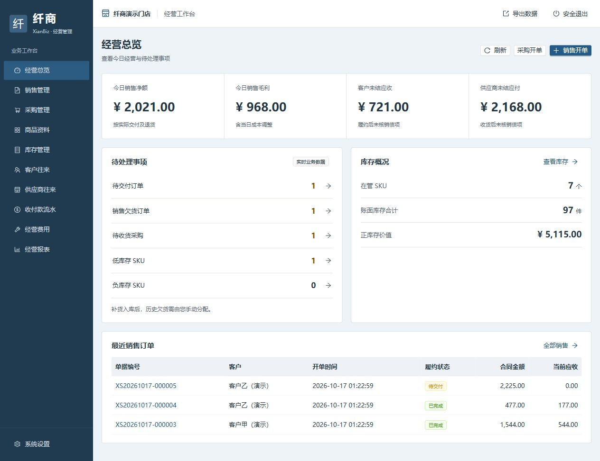
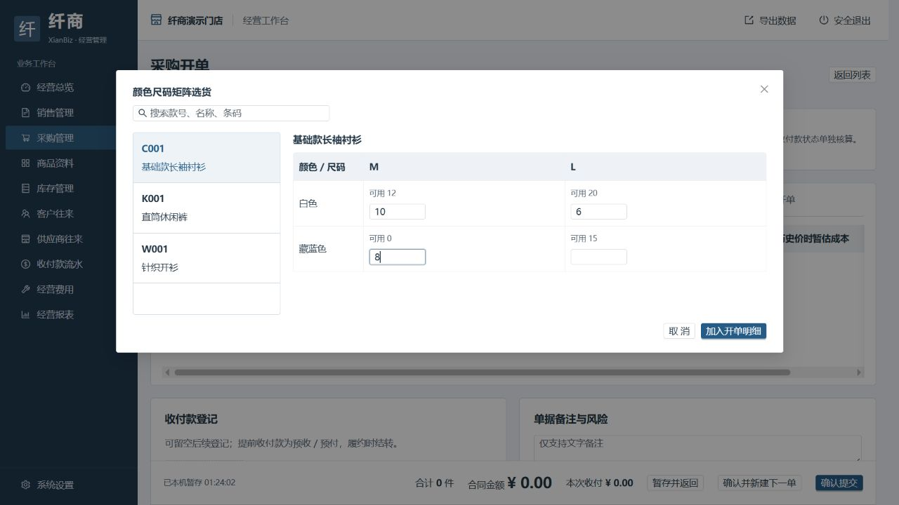
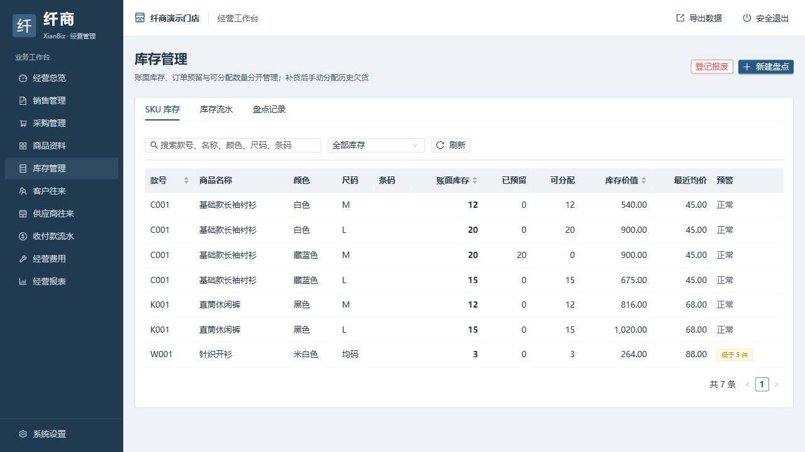

# XianBiz 纤商

面向服装批发档口的 Windows 单机离线进销存，覆盖商品颜色尺码、采购补货、销售预订、库存盘点、客户供应商往来及经营报表。

无需账号登录，经营数据保存在本机，支持手动完整备份。本仓库提供源码、测试与构建脚本，不包含本机经营数据及已编译安装包。

## 功能预览

以下界面使用独立演示数据，不包含真实经营资料。

### 经营总览

集中查看当日销售、毛利、应收应付和库存概况；待交付、欠货、待收货与低库存事项可直接进入处理。



### 采购开单与矩阵选货

按颜色和尺码批量填写采购件数，减少逐行选货。首次进货可在采购单中直接新增商品，后续补货复用已有档案；实际收货后才增加库存。



### 库存管理

分别展示账面库存、订单预留与可分配数量，并查看库存价值、最近均价和低库存预警；支持追溯库存流水和盘点记录。



## 项目结构

| 路径 | 内容 |
|---|---|
| `frontend/` | React / TypeScript 页面、样式与锁定依赖 |
| `backend/` | FastAPI 接口、SQLite 模型与业务规则 |
| `desktop/` | Windows 本地启动器及 PyInstaller 配置 |
| `installer/` | Inno Setup 安装脚本 |
| `scripts/` | 开发启动、完整构建及打包验证 |
| `tests/` | 业务、成本、导入导出、接口及性能测试 |
| `docs/` | 需求、设计、操作手册、验收记录与界面截图 |

## 启动

首次克隆后，先按下方步骤安装依赖并构建前端，再双击 `启动纤商.bat`。自行打包后，桌面程序位于 `dist/XianBiz/XianBiz.exe`，默认自动打开浏览器并使用动态端口；安装包位于 `artifacts/XianBiz-Setup-1.0.0.exe`。退出请使用页面右上角“安全退出”。

正式数据库首次为空，进入店铺启用向导。持久化目录：`%LOCALAPPDATA%/XianBiz`。不要把测试目录恢复到正式环境。完整备份由用户在设置里手动创建。

## 开发与构建

技术栈：React + TypeScript + Vite + Ant Design / Charts；FastAPI + SQLite；openpyxl；PyInstaller + Inno Setup。

依赖：Windows x64、Python 3.12、Node.js 24；安装后的桌面程序不需要预装 Python 或 Node。

```powershell
python -m venv .venv
.venv/Scripts/python -m pip install -r requirements.lock.txt
cd frontend
npm ci
npm run build
cd ..
.venv/Scripts/python -m pytest -q
.venv/Scripts/python desktop/launcher.py
```

开发运行也由后端同源提供构建文件。Vite 单独启动只用于静态界面开发；安全中间件不放开跨域。可设置 `XIANBIZ_DATA_DIR` 指向隔离目录，或启动器传 `--data-dir`。

执行 `scripts/build.ps1` 完成前端构建、测试、PyInstaller 和 Inno Setup。安装包编译器可在 PATH 中，或位于 `.tools/InnoSetup/ISCC.exe`。本次使用 Inno Setup 6.4.3，官方该版本许可允许商业应用使用；工具本体不随产品发布。升级编译器时须自行核对对应版本许可。

```powershell
.venv/Scripts/python scripts/smoke_packaged.py --exe dist/XianBiz/XianBiz.exe
```

打包验证仅在 `.runtime/packaged-smoke` 创建隔离数据。业务测试均使用 pytest 临时目录；生产没有预置客户、商品、订单或经营指标。
